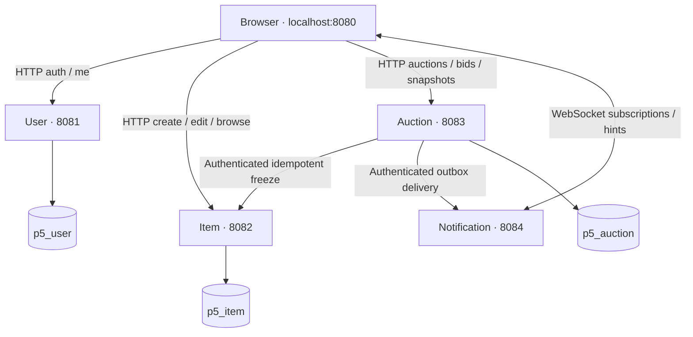
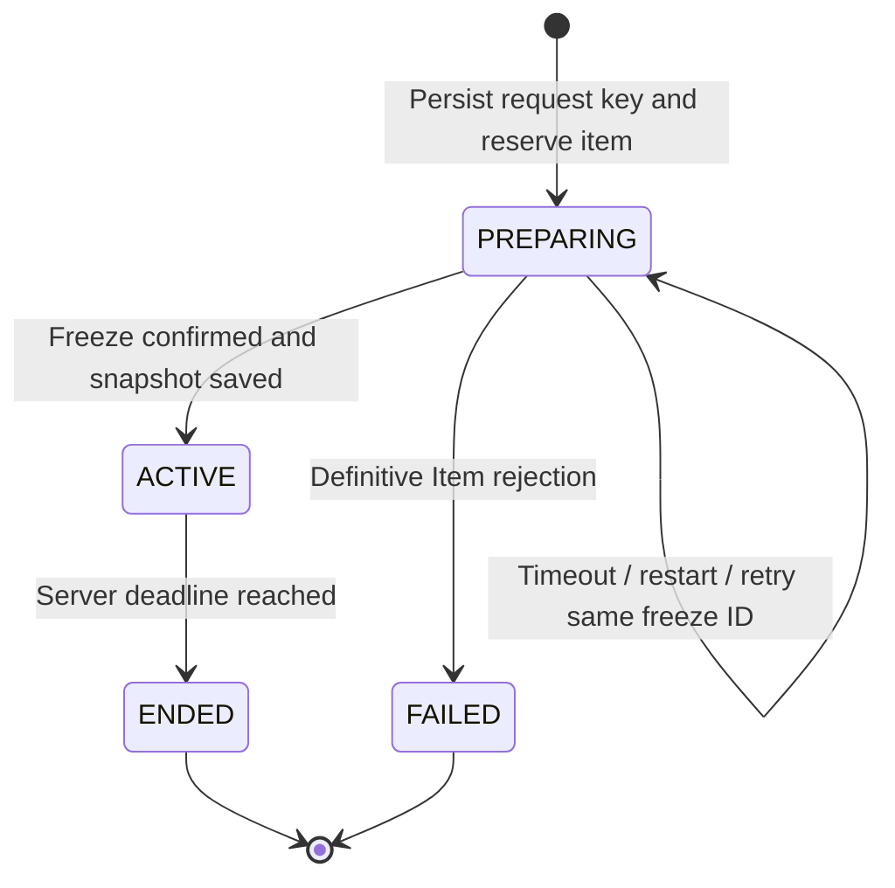

# Architecture

The local basic version implements four independent services. Earlier design documents are preserved under [history/skeleton-2026-11-03](history/skeleton-2026-11-03/README.md).

| Service | Owns | Storage |
| --- | --- | --- |
| User | Registration, BCrypt hashes, JWT issuance, current-user profile | `p5_user`, role `p5_user` |
| Item | Item descriptions, seller ownership, immutable auction freeze ID | `p5_item`, role `p5_item` |
| Auction | Creation recovery, snapshots, bids, deadlines, winners, outbox | `p5_auction`, role `p5_auction` |
| Notification | Active WebSocket sessions and auction subscriptions | In memory, no database |

The databases may share one PostgreSQL instance; accounts have no cross-database access. A browser-supplied seller/bidder ID is never authoritative. The JWT subject supplies identity; the trusted Auction service passes the seller ID to Item's authenticated internal freeze endpoint.

## Creation workflow

Only one non-failed auction is permitted per item. Creation returns 202 and a durable ID even if PREPARING. A recovery task resumes incomplete reservations every three seconds. Item freezing uses its own row lock; repeating the same auction ID succeeds, a different ID conflicts. No unlock is attempted after a timeout because the freeze may have succeeded. A failed ownership request does not freeze the item. Pending requests are resumed after service restart; expiry during recovery immediately produces an ended, unsold auction.

This first version keeps successful item freezes after auction end and does not offer cancellation or relisting the same item. Details are copied from the confirmed freeze into Auction, so browsing an existing auction remains possible while Item is temporarily unavailable.

## Bidding and finalization

`AuctionRepository.lock()` uses a PostgreSQL pessimistic write lock. Both `AuctionTransactions.bid()` and `end()` use it. Server time is checked after the lock, so a request queued before the deadline can still be rejected when it acquires the row afterwards. Accepted bid, highest price, leader, version and outbox entry are one transaction. The finalizer runs every second and scans overdue ACTIVE rows, including those missed while offline.

First bid: at least starting price. Later bid: at least current price + minimum increment. Seller bids are rejected. Money is bounded integer HUF, never floating point. A successful bidder/key replay returns the original bid even after expiry; reusing a key with a different amount conflicts. Unique database constraints complement row locks. Winner is the last accepted leader when status becomes ENDED; no leader means unsold.

Detail snapshots read auction state and the latest 50 bids within a repeatable-read transaction. Older history is paginated. Public list queries use bounded pagination; personal queries select selling, participated or won auctions.

## Reliability and operational boundaries

Outbox rows are committed with price/end changes. Delivery takes separate outbox locks with SKIP LOCKED and finite HTTP timeouts; failures retry with bounded exponential delays. They never roll back a previously accepted bid. Duplicate/late/out-of-order pushes are expected, so the frontend reads authoritative snapshots and ignores stale versions. Pushes contain no bidder email or password information.

Local servers bind loopback, browser origin is explicit, and internal event/freeze routes require a separate shared secret. Public auctions can be watched without logging in. JWTs expire after one hour. This is a local course project, not a hardened public deployment. See [decisions](decisions.md), [API protocol](communication.md) and [scope](project-description.md).
