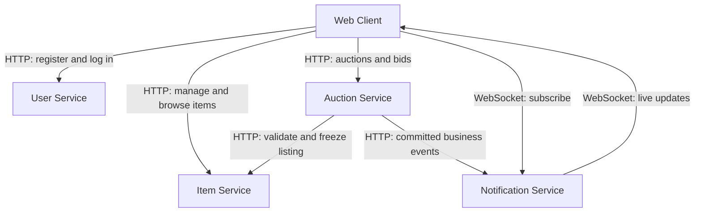

# Planned Architecture

## Service boundaries

Each service will run as a separate process and expose a network interface. They may run on the same development computer and live in this single repository.

| Component | Responsibilities | Owned data |
|---|---|---|
| User Service | Registration, login, identity and token issuance | Users and password hashes |
| Item Service | Create and browse listings; enforce ownership and listing edit rules | Items, seller IDs, descriptions and image references |
| Auction Service | Auction lifecycle, bid validation, bid history, current price and winner selection | Auctions, accepted bids and pending notification events |
| Notification Service | Manage WebSocket connections and auction subscriptions; distribute updates | In-memory subscriptions; no database required initially |
| Web Client | Display listings and auctions; submit user actions; render live updates | Temporary UI state |

Auction and bidding remain together because accepting a bid requires a consistent decision about the auction state and current price. Notification delivery is separated from that business decision.

Each persistent service owns its data. Other services use its API rather than directly accessing its tables. Separate logical databases may share a database server during development.

## Component diagram

## Data and business decisions

- The Auction Service stores the seller ID when an auction is created, after validating ownership with the Item Service.
- Listing freeze and auction creation need an idempotent workflow with compensation if creation fails; they are not one cross-service database transaction.
- Bid acceptance and auction closure use the same database concurrency control so that an ended auction cannot accept a late bid.
- Bid records, the current price, leading bidder and auction version are updated in one local transaction.
- Finalization is performed by a server-side task. An auction with no accepted bids ends without a winner.
- Passwords are stored as hashes. Protected endpoints validate login tokens and authorization.

## Reliability approach

A pending event is stored in the Auction Service database in the same transaction as the corresponding business change. A background dispatcher sends it to the Notification Service and retries failed deliveries. Events have unique IDs and auction versions because retries can cause duplicates.

The Notification Service does not determine prices or winners. Clients recover authoritative state from the Auction Service after reconnecting or detecting a version gap.

## Technology decisions

Programming language, framework, database product and WebSocket library are not selected yet. HTTP APIs and WebSocket are planned communication choices. A message broker is not required for the initial design.
