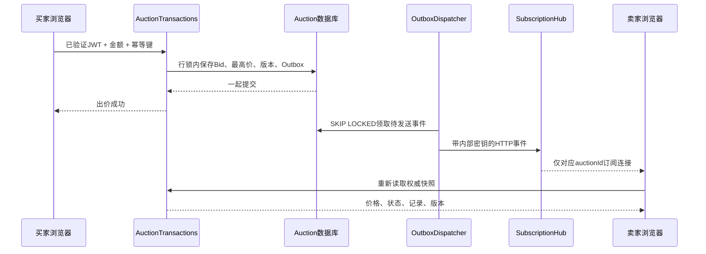

# 中文代码导读

下面的路径均相对于仓库根目录 `/Users/shilo/Projects/P5project`。这里描述的是已经存在的类和调用链，不是待开发方案。四个服务没有大型公共模块，各自可独立构建。

## ① 注册登录请求如何流转

从 [client/app.js](../client/app.js) 的 `authPage()` 开始。浏览器提交 email、password、displayName 到 User 服务；登录 token 只存本标签页的 sessionStorage，不写到 URL、控制台或日志。页面刷新后通过 `/api/users/me` 恢复当前用户。

1. [AuthController.java](../user-service/src/main/java/com/p5auction/user/controller/AuthController.java) 负责路由、`@Valid` 输入校验与 201 状态码，不直接访问数据库。
2. [AuthDtos.java](../user-service/src/main/java/com/p5auction/user/dto/AuthDtos.java) 定义请求/响应 record。紧凑构造器先去掉 email 两端空白并统一小写，再执行邮箱/长度校验；输出 UserView 只有 id、email、displayName。
3. [AuthService.java](../user-service/src/main/java/com/p5auction/user/service/AuthService.java) 用 BCrypt cost 12 计算哈希，检查 UTF-8 密码不超过 72 字节，通过 UserRepository 保存。注册接口不会回传实体或密码哈希。登录失败使用一致错误；账号不存在也比对一个 dummy hash。
4. [UserRepository.java](../user-service/src/main/java/com/p5auction/user/repository/UserRepository.java) 只查询 `p5_user` 中的 UserAccount；[V1__users.sql](../user-service/src/main/resources/db/migration/V1__users.sql) 的唯一约束保证并发注册也不能重复。
5. 登录成功使用 NimbusJwtEncoder 签发 HS256 JWT，包含 issuer、audience、subject、issuedAt 和一小时 expiresAt。随后各服务的 [SecurityConfig.java](../user-service/src/main/java/com/p5auction/user/config/SecurityConfig.java) 验证签名、算法、issuer、audience、UUID subject 与必需的过期时间，零时钟宽限。
6. Controller 从 `@AuthenticationPrincipal Jwt` 的 subject 获得用户 ID。请求体中即使额外传 userId / sellerId，也不会成为业务身份。

每个服务的 ApiErrors 将校验/业务异常转换为 Problem Details；未知异常只输出通用说明，不把 SQL、堆栈或秘密带到浏览器。SecurityConfig 则处理进入 Controller 前的 401/403。

## 商品和创建拍卖为何分成两步

[ItemController](../item-service/src/main/java/com/p5auction/item/controller/ItemController.java) → [ItemService](../item-service/src/main/java/com/p5auction/item/service/ItemService.java) → [ItemRepository](../item-service/src/main/java/com/p5auction/item/repository/ItemRepository.java) 负责商品。创建可携带稳定幂等键；修改和内部冻结都锁住商品行。卖家才可编辑；frozenBy 一旦属于拍卖就拒绝编辑。图片只接受不带凭据的 HTTP(S) URL，后端不下载该 URL。

[AuctionService.java](../auction-service/src/main/java/com/p5auction/auction/service/AuctionService.java) 协调创建，而 [AuctionTransactions.java](../auction-service/src/main/java/com/p5auction/auction/service/AuctionTransactions.java) 管理本地事务：先持久化 PREPARING 与原始请求参数，再用 RestClient 调用 Item 内部冻结。这个调用带内部专用密钥和稳定 auctionId，并有连接/读取超时。

冻结确认后 `activate()` 保存商品快照。超时不等于失败，不盲目解冻；`BackgroundJobs.recoverCreations()` 用同一 ID 继续。明确不属于卖家/商品不存在/被别的拍卖冻结则标 FAILED。这样服务在任意一步重启都能从数据库恢复，不需要跨库事务。前端发布草稿保留商品 ID 与请求键，可重试；丢弃本地草稿不会删除已保存的商品。My items 中可编辑未冻结商品或继续发起拍卖。

## ② 一次出价如何验证并保存

1. 详情页 bidForm 向 [AuctionController.java](../auction-service/src/main/java/com/p5auction/auction/controller/AuctionController.java) 发送整数 amount、JWT 和 Idempotency-Key。Controller 只解析和校验协议；身份来自 token。
2. `AuctionTransactions.bid()` 开启数据库事务，通过 [AuctionRepository.lock()](../auction-service/src/main/java/com/p5auction/auction/repository/AuctionRepository.java) 获得拍卖行的 `PESSIMISTIC_WRITE` 锁（PostgreSQL FOR UPDATE）。同一拍卖的并发出价在这里排队，不同拍卖可同时处理。
3. 锁内先找原 bidder/key。相同金额直接返回原 BidView，金额不同返回 409。随后检查 ACTIVE、**取得锁后的服务器当前时间**、卖家不能出价、第一笔至少起拍价/后续至少最高价加最低加价。
4. 校验成功后更新 currentPrice、leadingBidder、version，保存 [Bid](../auction-service/src/main/java/com/p5auction/auction/entity/Bid.java)，再保存 [OutboxEvent](../auction-service/src/main/java/com/p5auction/auction/entity/OutboxEvent.java)。三项修改处于同一个事务，提交成功才是接受出价。
5. 数据库 [V1__auctions.sql](../auction-service/src/main/resources/db/migration/V1__auctions.sql) 额外约束每个拍卖/用户/幂等键唯一、每个拍卖出价版本唯一、金额为正整数。
6. `BackgroundJobs.closeExpired()` 每秒查到期 ACTIVE；`tx.end()` 取得**同一把行锁**再检查时间与状态，设置 ENDED 并递增版本、记录 auction_ended outbox。有 leadingBidder 则获胜，无则未成交。重启后继续扫描遗漏记录。

金额都是 Java long / PostgreSQL bigint，单笔上限 10^12 HUF；JSON 小数在反序列化阶段拒绝。浏览器倒计时只展示，不决定接受与否。详情快照以 REPEATABLE_READ 同时读取价格、版本与最近 50 条记录，避免从两个事务拼出不一致状态。

## ③ 实时事件如何到达另一个浏览器

[OutboxDispatcher.java](../auction-service/src/main/java/com/p5auction/auction/service/OutboxDispatcher.java) 在独立事务领取小批量 outbox。失败记录下一次尝试时间，指数退避上限 60 秒；不会撤销已提交的出价。若远端已收但本地确认前崩溃，会重复发送，这是有意接受的至少一次投递。

[EventController.java](../notification-service/src/main/java/com/p5auction/notification/controller/EventController.java) 只接收通过内部密钥验证的事件。普通用户 JWT 不能伪造它。[SubscriptionHub.java](../notification-service/src/main/java/com/p5auction/notification/service/SubscriptionHub.java) 保存连接及各连接订阅的 auctionId 集合，只向匹配拍卖推送；负责订阅确认、ping/pong、断线清理和发送缓冲限制。它没有出价判定逻辑，也不访问拍卖数据库。

[client/live.js](../client/live.js) 的 LiveAuction 管理客户端连接：收到订阅确认才读快照；查询期间若来事件就再读一次；重连后重新订阅和读快照。版本缺口触发恢复，重复/旧事件忽略，低版本 HTTP 结果不能覆盖高版本。事件只提示“有变化”，不直接设置价格。十秒轮询兜底处理无后续版本可发现的最后一条丢失事件。[tests/live.test.mjs](../tests/live.test.mjs) 专门测试这些顺序竞态。

## ④ 每个关键类为什么存在

| 类/文件 | 存在原因 |
| --- | --- |
| 各 `*ServiceApplication` | 四个独立 JVM 的 Spring Boot 入口 |
| 各 HealthController | 保留统一进程存活探针，不宣称数据库或依赖健康 |
| 各 SecurityConfig | JWT、内部密钥、精确来源 CORS 和 HTTP 授权入口 |
| 各 ApiErrors | 安全且一致的错误协议 |
| AuthService / UserRepository / UserAccount | 分开认证规则、数据查询、持久化状态 |
| ItemService / ItemRepository / Item | 分开商品规则、锁查询与冻结状态 |
| AuctionController / AuctionDtos | 将 HTTP/输入输出与竞价事务解耦 |
| AuctionService | 处理跨服务创建恢复，避免网络调用混进出价事务 |
| AuctionTransactions | 明确锁、幂等、价格、结束、快照的事务边界 |
| AuctionRepository / BidRepository / OutboxRepository | 分开拍卖状态、出价历史与可靠投递的数据库查询 |
| Auction / Bid / OutboxEvent | 分别持久化权威快照、不可重复的出价、待投递事实 |
| BackgroundJobs | 周期结束、恢复 PREPARING、触发投递；任务线程池互相隔离 |
| HttpClients | 集中设置跨服务连接/读取超时 |
| EventController / SubscriptionHub / WebSocketConfig | 分开可信事件入口、订阅投递、WebSocket 来源配置 |
| `client/config.js` / `app.js` / `live.js` | 分开地址、可见页面交互、实时状态恢复 |
| `scripts/dev.py` | 可审查的初始化与进程所有权管理，不误杀、不重置数据库 |
| `tests/integration.py` | 用真实 HTTP、WebSocket、PostgreSQL 验证权限、并发、重启和故障恢复 |

建议先读本页，再依次看 AuthService、AuctionTransactions、AuctionService、OutboxDispatcher 和 live.js。不要把 entity 当作 Controller 输出 DTO，也不要绕开 Service 直接修改别的服务数据库。
