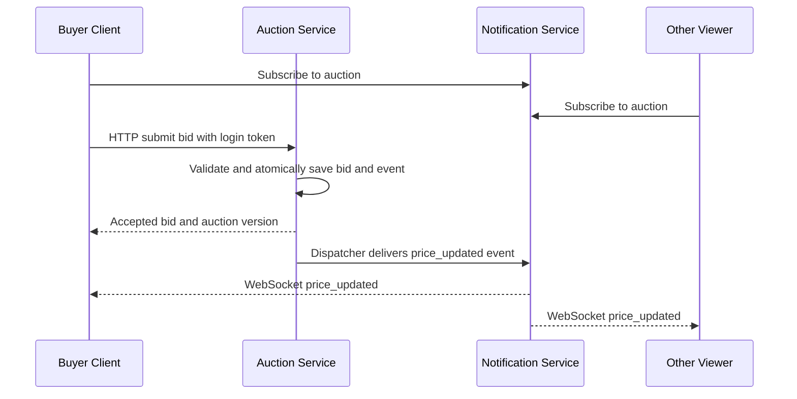

# Planned Communication

## Interfaces

These are proposed interfaces, not implemented endpoints.

| Caller | Receiver | Method | Purpose |
|---|---|---|---|
| Web Client | User Service | HTTP | Register and log in |
| Web Client | Item Service | HTTP | Create and browse listings |
| Web Client | Auction Service | HTTP | Create auctions, retrieve snapshots and submit bids |
| Auction Service | Item Service | Internal HTTP | Validate ownership and freeze a listing |
| Auction Service dispatcher | Notification Service | Internal HTTP | Deliver committed price and auction-ended events |
| Web Client | Notification Service | WebSocket | Subscribe and unsubscribe to auction updates |
| Notification Service | Web Client | WebSocket | Push price and status changes |

Internal event delivery must be authenticated. The Notification Service validates subscriptions and does not accept client messages that claim to change a price.

## Successful bid flow



The HTTP response and WebSocket update may arrive in either order. Clients use auction versions to avoid replacing newer state with an older update.

## Example update message

```json
{
  "type": "price_updated",
  "eventId": "event-123",
  "auctionId": "auction-25",
  "version": 7,
  "price": 1200,
  "currency": "HUF"
}
```

Amounts are represented as whole HUF for the initial version. Public price updates do not expose personal account details.

## Initial loading and reconnecting

1. Connect to the Notification Service and subscribe to the auction.
2. After subscription acknowledgement, buffer incoming updates while fetching the current auction snapshot through HTTP.
3. Render the snapshot and apply buffered updates with newer versions.
4. Ignore duplicate or older updates. If a version gap is detected, retrieve a fresh snapshot.
5. If disconnected, show the connection status and reconnect with a bounded retry delay, then repeat subscription and synchronization.

Heartbeat checks identify broken connections. The server removes closed connections from subscription groups.

## Errors and consistency

- Invalid or expired login: reject the protected operation.
- Bid below the required amount: reject it and return the current auction state.
- Auction ended: reject new bids using server time.
- Concurrent bids: serialize the relevant database updates or use conditional writes and retries.
- Notification delivery fails: retain the pending event and retry; an already committed bid remains accepted.
- A bid request times out: query its result or retry with the same idempotency key to avoid duplicate processing.
- A notification is missed: recover from the authoritative HTTP snapshot.

## Planned verification

- Two clients receive a committed price change without refreshing.
- Invalid bids do not change the price or produce successful-bid events.
- Concurrent bids cannot lower the current price.
- The seller cannot bid on their own item.
- Bids at or after the end time are rejected.
- Reconnecting clients recover the latest state.
- Duplicate or out-of-order events do not roll back the displayed state.
