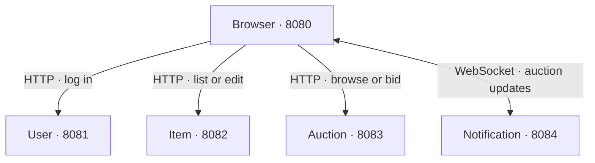
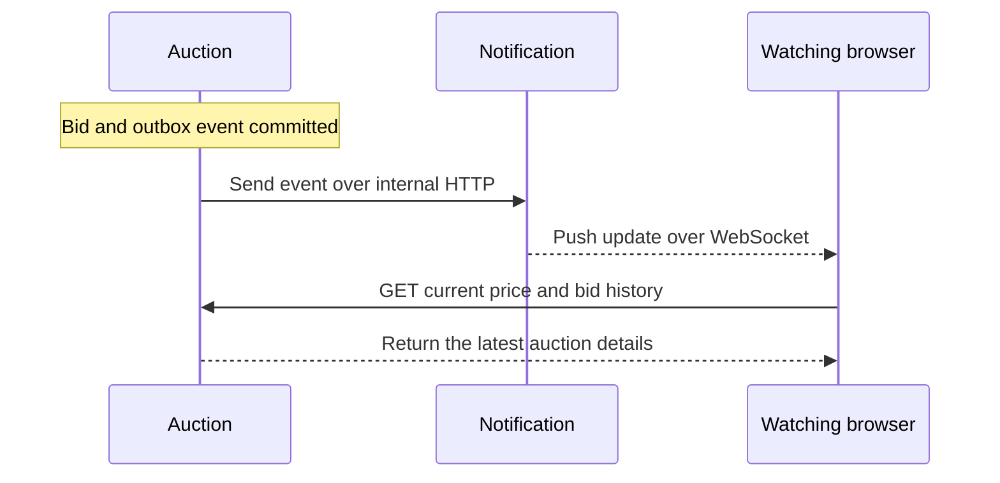

<!--@slide SecondRound-->
# SecondRound

A second-hand auction website

TAOFUYUAN · Programming 5

- A seller lists a used item and sets a starting price and an end time.
- Buyers place bids in HUF.
- Everyone watching the auction can see the new price without refreshing.

<!-- @note -->
> Start with two browsers. A buyer places a bid in one, and the seller sees the price change in the other. The rest of the presentation explains what happens between those two screens.

---

<!--@slide Architecture-->
# One client, four services



User, Item and Auction each own a PostgreSQL database. Notification keeps active subscriptions in memory.

<!-- @note -->
> User issues login tokens. Item stores the listings. Auction decides which bids to accept and who wins. Notification tells the subscribed browsers about changes. The databases share one local PostgreSQL instance, with a separate database and account for each service that stores data. The Java services are separate Maven projects and run as separate processes.

---

<!--@slide Publishing-->
# Publishing crosses a service boundary

1. The browser sends the listing to Item.
2. The browser asks Auction to start an auction for that item.
3. Auction saves a pending record and calls Item over HTTP to freeze the listing.
4. After Item confirms the freeze, Auction starts the auction.

<!-- @note -->
> The internal endpoint is POST /internal/items/{id}/freeze. If the call times out, Auction keeps the pending record and retries with the same auction ID. Item can confirm an earlier freeze for that ID. This is why the code saves the pending record before making the network call. The auction keeps a copy of the frozen details.

---

<!--@slide Controller-->
# Code · Receiving a bid

`POST /api/auctions/{id}/bids`

```java
AuctionService.key(key);
return tx.bid(id, UUID.fromString(jwt.getSubject()), key, request.amount());
```

- The URL gives the auction ID.
- The verified JWT gives the bidder's ID.
- The request body gives the amount. The request header carries the retry key.

[Open AuctionController.java](../../project/auction-service/src/main/java/com/p5auction/auction/controller/AuctionController.java#L21)

<!-- @note -->
> The two statements come from the real Controller. Whitespace was adjusted for the slide. Spring MVC reads the path, the body and Idempotency-Key. Spring Security supplies the verified token. The call to tx.bid is a Java method call within the auction service.

---

<!--@slide Transaction-->
# Code · Accepting a bid

Inside `AuctionTransactions.bid()`

1. Lock the auction row. If the same bidder and key were already used for this amount, return the earlier bid.
2. Check the deadline, the seller rule and the minimum bid.
3. Save the bid, the new auction state and a notification record in one transaction.

```java
Bid bid = bids.save(new Bid(a, bidder, amount, key));
event(a, "price_updated");
```

[Open AuctionTransactions.java](../../project/auction-service/src/main/java/com/p5auction/auction/service/AuctionTransactions.java#L50)

<!-- @note -->
> Two bids for the same auction have to take the same lock. The second request checks the latest price when it gets the lock. event(...) saves a row in the outbox table inside the same transaction. Auction can retry sending this event later if Notification is unavailable.

---

<!--@slide Realtime-->
# How the other browser gets the new price



The page also reads the latest details after reconnecting.

<!-- @note -->
> Auction sends the event from a scheduled job. Notification only pushes it to browsers subscribed to this auction. The WebSocket message tells the browser something changed, and the browser reads the current price over HTTP. A ten-second HTTP check is the fallback if a push is missed.

---

<!--@slide Programming 5-->
# Where this fits in Programming 5

| Course topic | Where to see it in SecondRound |
| --- | --- |
| Architecture views and microservices · Ch. 1, 3 | One GitHub repo, four backend builds and four running service processes |
| Data ownership and consistency · Ch. 5 | Separate databases. Auction commits the bid and its outbox event together. |
| Remote calls, retries and identity · Ch. 6 | Auction calls Item over HTTP. The same bid key is reused after a timeout. The service reads user identity from the JWT. |
| HTTP APIs · Ch. 7 | The browser submits a bid with POST and reads the auction state with GET. |
| Events and delivery · Ch. 4, 8 | Auction sends price changes in the background and retries failed deliveries. |
| Polling and WebSocket · Ch. 9, 10 | Notification pushes changes. The browser reads the latest state and falls back to polling. |

[Programming 5 course material](https://pte-mik.github.io/info/programming-5-en/)

<!-- @note -->
> Point to one example per row. The strongest example of a trade-off is that a bid can be saved while Notification is offline. The browser may see the update later, once it reconnects or checks Auction again.

---

<!--@slide Demo-->
# Demo · Watch a bid appear

1. Sign in as the seller and open a published auction.
2. Open the same auction as a buyer in a separate browser profile. Place a valid bid.
3. Look at the seller's screen. The price and bid history update while the page stays open.

[Open the demo instructions](../../project/README.md#try-live-bidding)

<!-- @note -->
> Give the auction enough time so it stays open during the demo. Point to the price and bid history in both windows. If there is time, let the auction end so the audience can see the winning bid.
