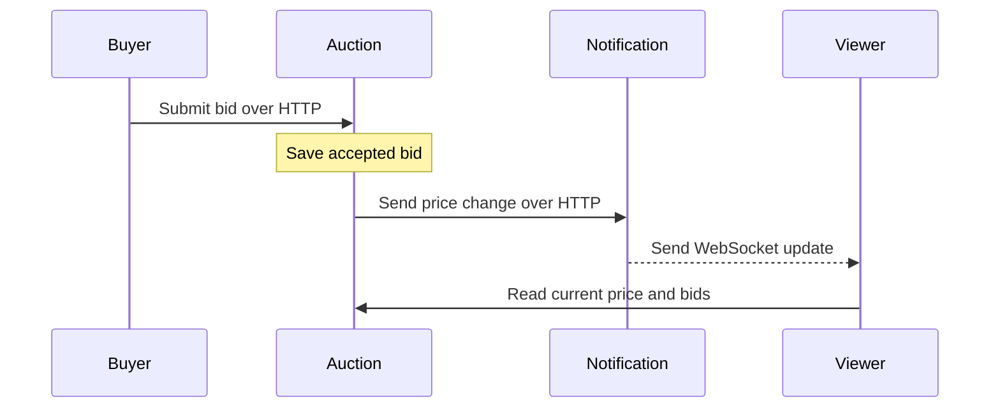

<!--@slide Opening-->
# What Does Architecture Mean?

Code, runtime and deployment

TAOFUYUAN · Programming 5 · 01-01

> If an app has four folders, does it have four services?

<!-- @note -->
> Start with the question. Explain that a folder tells us where code lives. We also have to look at how the app runs and how it is released.

---

<!--@slide Three views-->
# Three views of one system

| View | Question |
| --- | --- |
| Code | Where is each responsibility implemented? |
| Runtime | What is running, and how do the parts talk? |
| Deployment | What can we release or replace separately? |

Architecture is about the parts, their relationships and decisions that are hard to change later.

<!-- @note -->
> For example, renaming a Java method is usually a local change. Turning that method into a network call changes how the caller sends data and handles a failure.

---

<!--@slide Code-->
# Code view

I keep SecondRound in one GitHub repository.

- `user-service` handles accounts and login.
- `item-service` stores the items for sale.
- `auction-service` decides which bids to accept and when auctions end.
- `notification-service` tells viewers when an auction changes.

<!-- @note -->
> Use bidding as the example. I look in Auction for the minimum-bid rule. I look in Notification to see which browsers receive the update. Each of the four folders is a Maven project.

---

<!--@slide Runtime-->
# Runtime view · A bid comes in

<!-- @note -->
> Auction and Notification are separate Java processes on ports 8083 and 8084. Once a bid is saved, a background job in Auction sends the event to Notification. The viewer's browser then reads the latest auction data. If the notification arrives late, the saved bid still exists.

---

<!--@slide Deployment-->
# Deployment view

Each backend builds its own JAR. If I change only Notification, I can rebuild and restart that service while Auction keeps running.

The Mac startup script starts the services together for convenience. Each service still has its own build and process.

<!-- @note -->
> This example assumes the HTTP and WebSocket contracts stay compatible. The Notification Maven Wrapper can build its JAR on its own. Use the service-specific stop and start commands to restart only Notification.

---

<!--@slide Quick check-->
# Four processes, how many releases?

Imagine four copies of the same app running to handle more traffic. Each copy comes from the same release package.

<!-- @reveal -->

- **Runtime** has four running instances.
- **Deployment** has one deployable application.

<!-- @note -->
> Ask the room, then reveal the answer. If the team fixes one part of the app, it still rebuilds and releases the whole package. All four copies then run that release.

---

<!--@slide Takeaway-->
# How I check a service boundary

1. Find where the responsibility lives in the code.
2. Trace the calls between the running parts.
3. Check what can be built and released on its own.

[Course lesson 01-01](https://pte-mik.github.io/info/programming-5-en/content/01/01-01-architecture-views/)
