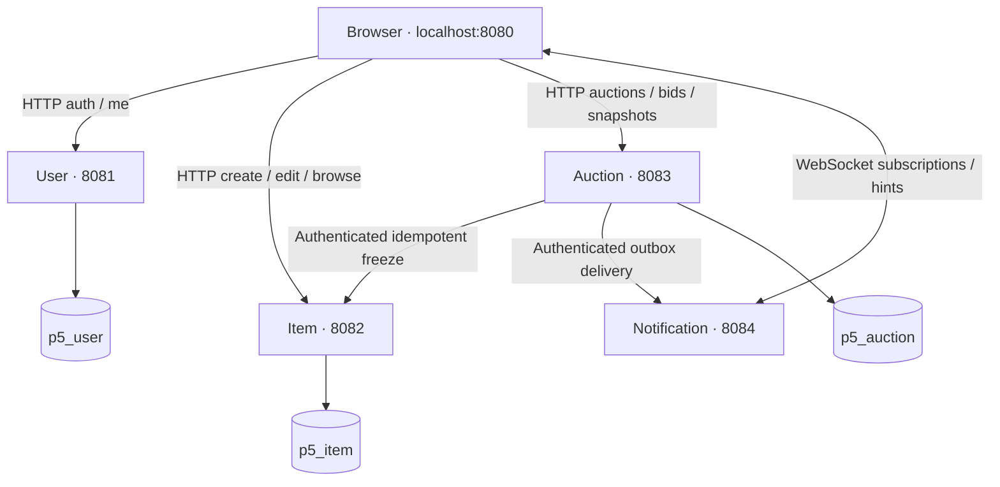
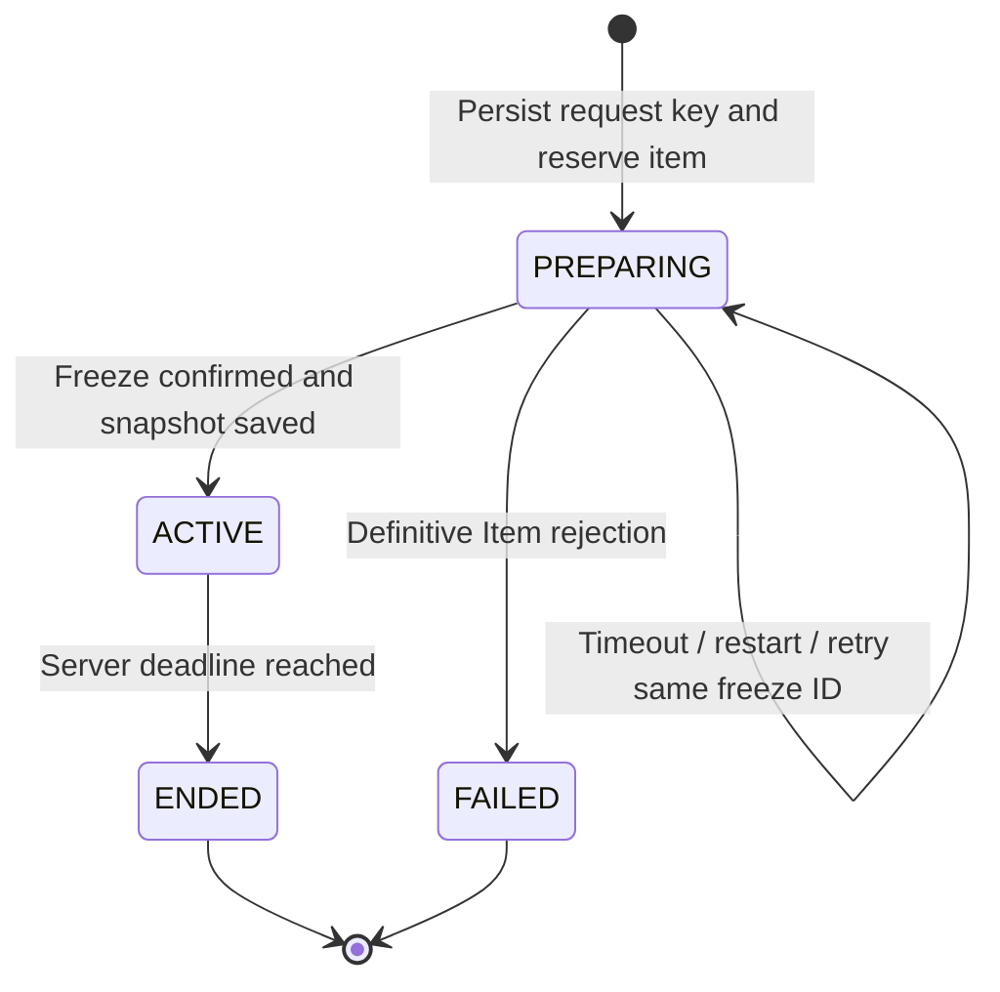

# Architecture

Opening an auction page uses two connections. The browser reads the price and bid history from Auction over HTTP, and it listens for changes from Notification over WebSocket.

| Service | Owns | Storage |
| --- | --- | --- |
| User | Accounts, password hashes and login tokens | `p5_user`, role `p5_user` |
| Item | Listings, seller IDs and the auction that froze each item | `p5_item`, role `p5_item` |
| Auction | Auctions, bids, winners and events waiting to be sent | `p5_auction`, role `p5_auction` |
| Notification | Active WebSocket sessions and auction subscriptions | In memory, no database |

The three databases run on the same local PostgreSQL instance and use separate accounts. When a user publishes or bids, the receiving service takes the user ID from the signed token. For a freeze, Auction passes the seller ID to Item using an internal credential.

## Creation workflow

Auction saves the request as `PREPARING` before it calls Item. If the call times out, a background job tries again every three seconds with the same auction ID. Item can confirm an earlier freeze for that ID. Once Item confirms, Auction copies the listing details into its own database and can serve them while Item is offline.

One item can have one non-failed auction. If the deadline passes while setup is pending, the recovered auction ends unsold.

## Handling bids

Auction locks the row before it checks the deadline and the minimum bid. The bid, price, leader, version and event are written in one transaction. The job that closes auctions takes the same lock, so closing and accepting a bid on the same auction happen in order. A duplicate submission with the same key and amount returns the original bid.

## Sending updates

A background job reads unsent events from the outbox and calls Notification over HTTP. Notification sends the event to browsers watching that auction. On a notification the browser fetches a fresh HTTP snapshot. This also lets it catch up after a reconnect. See the [message formats](communication.md) and [design notes](decisions.md).
