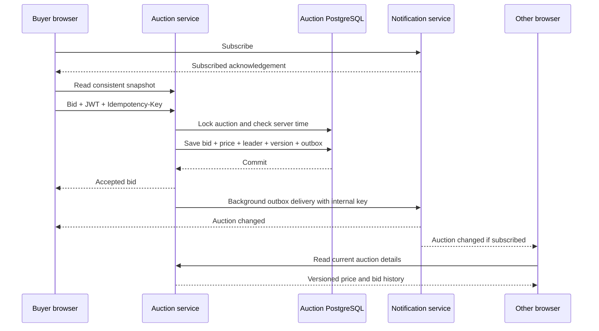

# HTTP and WebSocket interfaces

The browser uses HTTP for actions like posting a bid and WebSocket to hear that an auction changed. Requests and responses use JSON and UUIDs. Timestamps use UTC ISO 8601. Bids are whole HUF from 1 to 10¹². Requests that need login send `Authorization: Bearer <token>`.

## HTTP API

| Service | Method / path | Access and behavior |
| --- | --- | --- |
| All | `GET /api/health` | Public, `{service,status}`; process liveness only |
| User 8081 | `POST /api/auth/register` | `{email,password,displayName}` → 201 user DTO |
| User | `POST /api/auth/login` | `{email,password}` → accessToken, tokenType, expiresIn=3600, user |
| User | `GET /api/users/me` | Login → id, email, displayName; never a hash |
| Item 8082 | `POST /api/items` | Login; `{name,description,imageUrl}` → 201 item; optional Idempotency-Key |
| Item | `GET /api/items?page=0&size=20` | Public, bounded page (max 50) |
| Item | `GET /api/items/{id}` | Public details |
| Item | `GET /api/items/mine` | Login, paginated owned items |
| Item | `PUT /api/items/{id}` | Seller only, same write DTO; frozen items conflict |
| Auction 8083 | `POST /api/auctions` | Login + Idempotency-Key; `{itemId,startingPrice,minimumIncrement,endsAt}` → 202 state DTO |
| Auction | `GET /api/auctions?q=chair&page=0&size=20` | Public searchable ACTIVE/ENDED list (max 50) |
| Auction | `GET /api/auctions/{id}` | Public `{auction,bids,bidCount}` consistent snapshot, latest 50 bids |
| Auction | `GET /api/auctions/{id}/bids?page=0&size=50` | Public history, max 100 per page, newest version first |
| Auction | `POST /api/auctions/{id}/bids` | Login + Idempotency-Key; `{amount}` → 201 accepted/original bid DTO |
| Auction | `GET /api/auctions/mine` | Login, paginated selling states including PREPARING/FAILED |
| Auction | `GET /api/auctions/participated` | Login, paginated auctions with this user's accepted bids |
| Auction | `GET /api/auctions/won` | Login, paginated ENDED auctions won by this user |
| Item | `POST /internal/items/{id}/freeze` | Internal key only, `{auctionId,sellerId}` → confirmed item snapshot |
| Notification 8084 | `POST /internal/events` | Internal key only, confirmed event → 204 |

Idempotency-Key is 8–100 ASCII letters/digits/hyphens/underscores; UUID strings work. Auction creation keys are scoped to seller, bid keys to auction+bidder, item keys to seller. Replaying the same operation returns the same ID. Different immutable parameters with the same key return 409. Concurrent item creation with a shared key may return 409 from the unique constraint; retry the same request to recover its ID. The client retains stable request keys during uncertain network outcomes.

Auction state includes id, itemId, sellerId, name, description, imageUrl, startingPrice, minimumIncrement, currentPrice, nextMinimum, leadingBidder, status, failure, endsAt, version and serverTime. Without any bid, currentPrice displays the starting price and nextMinimum is still the starting price. PREPARING has no item snapshot yet; FAILED carries a safe explanation. ENDED plus null leadingBidder means unsold.

Page responses contain `content`, `totalElements`, `page`, `size`. Bid DTOs contain id, bidderId, amount, createdAt and version. No password/hash is serialized.

Errors use `application/problem+json` (type/status/detail plus standard Spring fields). 400 malformed/invalid data, 401 login/token, 403 ownership, 404 missing resource, 409 auction/idempotency/business conflict. Unknown internal failures return a generic 500. SQL, stack traces and configuration secrets are never sent to clients.

Internal requests send **X-Internal-Key**, a distinct environment secret unavailable to the client. Normal JWTs cannot call internal endpoints. Auction's outbound connect timeout is 2 seconds and read timeout 3 seconds. Mutating internal freeze retries always reuse the auction UUID.

## WebSocket protocol

Connect to `ws://localhost:8084/ws` with browser origin `http://localhost:8080`. Viewing auctions is public, so subscriptions do not require a token. The server permits at most 32 auction subscriptions per connection and bounds message size and output buffering.

Subscribe:

```json
{"action":"subscribe","auctionId":"a-valid-auction-uuid"}
```

Acknowledgement:

```json
{"type":"subscribed","auctionId":"a-valid-auction-uuid"}
```

Unsubscribe uses `action: "unsubscribe"`. Invalid messages close the connection. Server WebSocket ping frames run every 20 seconds; missing pongs for 60 seconds remove the connection. Browsers answer protocol pings automatically.

Example of a price update

```json
{
  "eventId":"d5e60cba-7013-4e17-a873-5bdac41f3336",
  "auctionId":"dc4c5875-2b64-44e3-af0c-608a0e23dbb3",
  "version":2,
  "type":"price_updated",
  "price":1200,
  "status":"ACTIVE",
  "winnerId":null
}
```

`auction_ended` has status ENDED and an optional winnerId. UUID event IDs remain stable through retries. Version increases for every accepted bid and once for finalization. Events are sent only to that auction's subscribers. Client messages cannot create price/end events.

## Bid and update flow



## What happens on reconnect

After reconnecting, the page subscribes again and asks Auction for the latest price and bid history. If another event arrives during that HTTP request, the page reads again. It ignores duplicate events and keeps the newer data if responses arrive out of order.

The page also checks over HTTP every ten seconds in case it misses a final event. The countdown uses server time as a reference. The server itself decides whether a bid arrived in time.
